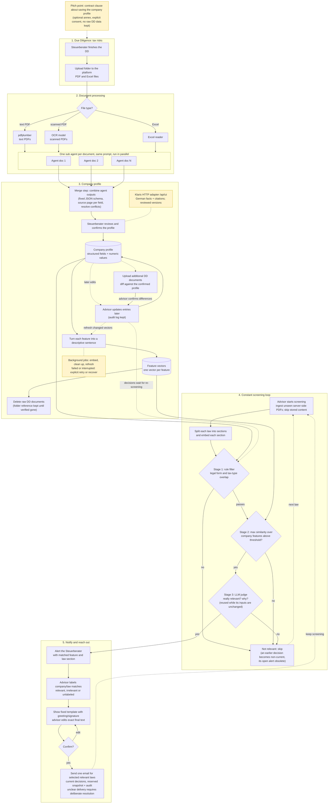

<p align="center">
  <picture>
    <source media="(prefers-color-scheme: dark)" srcset="docs/klaris-logo-light.png">
    
  </picture>
</p>

<p align="center">
  <b>From due diligence to proactive tax advice.</b><br>
  Klaris turns a DD data room into a living company profile, screens new tax law against it
  and tells the Steuerberater which clients to call, with the email already written.
</p>

<p align="center">
  
  
  
  
  
</p>

---

## The problem

After a due diligence, a tax advisor knows a company better than ever: its loss
carryforwards, shareholder changes, open tax years, real estate, intercompany loans. Then
the DD folder disappears into an archive. Months later a BFH ruling or a BMF letter changes
the rules for exactly that situation, and nobody connects the two.

## What Klaris does

1. **Upload the DD folder** (PDF and Excel). Klaris reads every document in parallel, with
   one AI agent per document, including scanned pages.
2. **Get a company profile** in which every value cites its source file and page.
   Conflicts between documents are kept side by side and shown to the advisor, never
   silently resolved.
3. **Confirm it.** The advisor stays in charge, and edits later are audited. Once the
   profile is confirmed, the raw DD documents are deleted; only the profile and its
   citations remain.
4. **Screen new law.** Klaris splits rulings and letters into sections and matches them
   against the profile in three stages: hard rules, vector similarity, then an LLM judge
   that has to explain *why* a client is affected.
5. **Reach out.** For each relevant change the advisor gets an alert and a ready email
   (one fixed template, no AI-written client mail), edits it and confirms the send. The
   calendar tracks replies and agreed Besprechungen.

> Human in the loop by design: the advisor confirms every profile and every email.

## Highlights

| | |
|---|---|
| **Every fact has a source** | Filename and page for each value; no value without a citation. |
| **Deterministic merge** | Plain code, no LLM, combines the agents' results. Agreement across documents means confirmed; disagreement means a conflict for the advisor. |
| **Explainable matching** | Rule filter, then max cosine similarity per feature, then an LLM judge with a written reason. Unchanged inputs reuse earlier verdicts at zero token cost. |
| **Privacy first** | Raw DD documents are deleted after confirmation; feature sentences contain no names or figures. |
| **Works in the background** | Uploads and screenings run as durable jobs, shown in the top bar with live status and pop-up results. |
| **Full audit trail** | Confirmations, edits, template changes, sends and client replies are logged. |

## How it works



The same diagram lives in [`Project Diagram.mmd`](Project%20Diagram.mmd).

## Tech stack

| Layer | Technology |
|---|---|
| Frontend | React 19, Vite, TypeScript, Tailwind CSS 4, TanStack Query, lucide icons, sonner toasts |
| Backend | Python 3.12 with `uv`, FastAPI, Pydantic, asyncio |
| Documents | pdfplumber (text PDFs), GPT vision (scanned pages), openpyxl (Excel) |
| AI | OpenAI `gpt-6-luna` (extraction, law metadata, judge), `text-embedding-3-small` |
| Database | PostgreSQL with pgvector |
| Mail | Gmail SMTP with an app password, or local JSON files (`MAIL_MODE=log`) |
| Hosting | Docker Compose on one VM: Caddy (HTTPS and login gate), API, Postgres |

## Repository layout

```
backend/            FastAPI service, pipeline, matching, mail (see backend/README.md)
  app/              application code (api, agents, profile, matching, services, ui, db)
  db_scheme/        Postgres schema "profil" and vocabulary
  mock_laws/        source PDFs the screening reads (BFH I R 1/23, I R 37/22)
  tests/            pytest suite (fake LLM and fake mail, no network)
frontend/           React app (see frontend/README.md)
screening/contract/ JSON Schemas shared by frontend and backend
docs/               README assets
compose.prod.yml    production stack; Caddyfile is its entry point
Project Brief.md    design decisions and data model
```

## Run it locally

You need Python 3.12 with [uv](https://docs.astral.sh/uv/), Node 22, Docker and an OpenAI API key.

```bash
# 1. Database
cd backend
docker compose up -d

# 2. Backend (http://127.0.0.1:8000, API docs at /docs)
cp .env.example .env        # set OPENAI_API_KEY, REPOSITORY=postgres,
                            # DATABASE_URL=postgresql://dd:dd@localhost:5432/dd
uv sync
uv run python -m app.api

# 3. Frontend (http://127.0.0.1:5173)
cd ../frontend
cp .env.example .env.local  # VITE_DATA_SOURCE=http, VITE_API_URL=http://127.0.0.1:8000
npm ci
npm run dev
```

Without `VITE_DATA_SOURCE=http` the frontend runs on built-in sample data, with no backend
needed.

**Try it:** upload a DD folder under *Mandanten*, keep working while the top bar shows
progress, open the new client, then press *Screening starten* under *Gesetzesänderungen*.
Matches pop up at the top right. *Einstellungen → Alles zurücksetzen* starts over.

## Deploy on a VM

```bash
cp .env.production.example .env   # domain, login hash, DB password, OpenAI key, mail
docker compose -f compose.prod.yml up -d --build
```

Caddy obtains HTTPS certificates, puts a login in front of the whole app and proxies `/api`
to the backend. For real email set `MAIL_MODE=smtp` together with `GMAIL_ADDRESS` and
`GMAIL_APP_PASSWORD`. Keep `MAIL_REDIRECT_TO` set while testing so that every mail goes to
you, and make sure the VM can reach `smtp.gmail.com:587`.

## Tests

```bash
cd backend  && uv run pytest && uv run ruff check .
cd frontend && npm run typecheck && npm test && npm run build
```

The tests never call OpenAI or send mail. Postgres integration tests run when
`TEST_DATABASE_URL` is set; use a separate, disposable database for them. Tests that need the
mock data room skip unless its PDFs are in `backend/mock_files/` (they ship with the
submission, not with the repository).

## Status

Klaris is a hackathon prototype working on mock data: one Steuerberater, no user accounts,
and law sources limited to the PDFs in `backend/mock_laws`. Automatic fetching from BMF,
NeuRIS, Bundestag DIP and EUR-Lex, EU-only hosting with an AVV (data processing agreement)
and multi-user support are the next steps.
