# Datenbankschema – Tax Company Profile (Prototyp)

PostgreSQL-Schema `profil` für das Company Profile nach der Tax Due Diligence. Es bildet **genau die Prototyp-Felder** ab, die im Lösungsprofil Nordhafen verwendet werden, und ist mit dieser Lösung als Testdaten befüllt. (Marschland ist in Arbeit und noch nicht enthalten.)

> Alle Inhalte sind fiktiv (Tax Tech Hackathon).

## Dateien und Reihenfolge

| Datei | Inhalt |
|---|---|
| `01_schema.sql` | Typen, Vokabular-Tabellen, Deal, Dokumente, alle Profil-Tabellen (Blöcke A–K, M) |
| `02_vokabular.sql` | Feste Listen: Dokumentklassen mit **Rang**, Normen, Merkmale (Feld-IDs) und deren Normbezug |
| `03_scan_und_views.sql` | Urteile, Embeddings, Alerts; Sichten für Block L (Fristen), offene Jahre, Direkttreffer, offene Punkte |
| `10_seed_nordhafen.sql` | Lösungsprofil Nordhafen Logistik GmbH |
| `90_tests.sql` | 15 automatische Prüfungen gegen die Lösungsschlüssel inkl. aller Fallstricke |

```bash
for f in 01_schema.sql 02_vokabular.sql 03_scan_und_views.sql 10_seed_nordhafen.sql 90_tests.sql; do
  psql -v ON_ERROR_STOP=1 -f $f
done
```

Getestet mit PostgreSQL 16.

## Designentscheidungen

1. **Ein Profil pro Gesellschaft.** `gesellschaft` hängt an einem `deal`. Organschaft, Verlustvorträge und Verfahrensstand liegen immer bei der einzelnen Gesellschaft.
2. **Drei Zustände.** `merkmal_wert.wert` ist `ja | nein | unbekannt`. Schweigen einer Quelle ergibt `unbekannt`, nie `nein`. Die Details (Listen) stehen in eigenen Tabellen.
3. **Festes Vokabular.** Normen (`norm`) und Merkmale (`merkmal_def`, Codes = Feld-IDs wie `B04`) sind Referenztabellen. Urteile werden mit **denselben** Codes verschlagwortet (`urteil_norm`, `urteil_merkmal`), damit der Abgleich deterministisch funktioniert.
4. **Provenienz an jedem Fakt (Block M).** Jede Faktentabelle trägt `quelle_dok`, `fundstelle`, `stand`, `konfidenz`, `bestaetigt_von`, `bestaetigt_am`, `gueltig_bis`.
5. **Rangfolge der Quellen.** `dokument_klasse.rang` (1 = Bescheid/Register/Vertrag … 3 = DD-Report … 9 = Entwurf). Konflikte werden in `pruefhinweis` mit Entscheidung festgehalten.
6. **Block L wird berechnet, nicht erfasst.** `v_fristen` sammelt Verjährung, Sperrfristen, GAV-Mindestlaufzeit und SPA-Fristen und markiert `alert`, `gehemmt`, `ausgeloest`, `abgelaufen`.
7. **Aktenzeichen als harter Schlüssel.** `v_aktenzeichen_im_profil` sammelt alle Musterverfahren aus Einsprüchen (C05), Vorläufigkeiten (C03) und Findings (K). `v_direkte_treffer` verknüpft sie mit neuen Urteilen.
8. **Embeddings auf Feldebene.** `embedding` speichert je Finding, Merkmal oder Rechtsfrage einen Vektor mit Filter-Metadaten (Steuerarten, Normen, Jahre, offen ja/nein). Für den Produktivbetrieb die Spalte mit pgvector als `vector(1536)` anlegen. Merkmale mit `nein` werden nicht embedded.

## Mapping Feld-ID → Tabelle

Block M now includes nullable `gesellschaft.ansprechpartner_email`, next to
`ansprechpartner_mandant`: the client's contact address, never an advisor firm's address.
Existing databases receive it through `app/db/migrations/007_contact_email.sql`; resets
retain it through `01_schema.sql`. TODO for the schema/fixture teammates: add an explicitly
stated client address to a fixture and seed if desired. Nordhafen currently has no client
address; `kanzlei@ro-stb.example` belongs to the advisor and must not populate this field.

| Feld | Bedeutung | Tabelle / Spalte |
|---|---|---|
| A01 | Deal-Typ, Signing, Closing | `deal.deal_typ, signing_am, closing_am` |
| A02 | DD-Art und Stand | `deal.dd_art, dd_umfang, dd_ersteller, dd_report_am, dd_datenraum_stichtag, dd_zeitraum_von/bis` |
| A04 | Name, Sitz, Land | `gesellschaft.name, strasse, plz, ort, land, registergericht, registernummer` |
| A05 | Rechtsform | `gesellschaft.rechtsform` |
| A06 | Rolle im Konzern | `gesellschaft.rolle` |
| A07 | Branche | `gesellschaft.wz_code, wz_bezeichnung` |
| B01 | Gesellschafter aktuell | `beteiligung` mit `gueltig_bis IS NULL` → Sicht `v_gesellschafter_aktuell` |
| B02 | Anteilswechsel 10 Jahre | `anteilswechsel` |
| B04 | KSt-/GewSt-Organschaft | `merkmal_wert (B04)` + `organschaft (art = kst_gewst)` |
| B05 | USt-Organschaft | `merkmal_wert (B05)` + `organschaft (art = ust)` |
| B07 | Auslandsbezug | `merkmal_wert (B07)` + `auslandsbezug` (Status auch `unbekannt`) |
| C01–C03, C06 | Veranlagung, Vorbehalt, Vorläufigkeit, Verjährung | `veranlagung` (Gesellschaft × Jahr × Steuerart × Bescheidart) |
| C04, C05 | Einsprüche, ruhende Verfahren | `merkmal_wert (C04)` + `rechtsbehelf.musterverfahren_az` |
| C07, C08 | Letzte BP und Feststellungen | `aussenpruefung (status = abgeschlossen)` + `pruefungsfeststellung` |
| C09 | Laufende/angeordnete BP | `merkmal_wert (C09)` + `aussenpruefung (status = angeordnet/laufend)` |
| D01, D02, D04 | Verlustvorträge, Zinsvortrag | `steuerattribut` (mit `festgestellt`, `sperre`) |
| E01 | Gesellschafterdarlehen | `merkmal_wert (E01)` + `darlehen` (inkl. Abtretung) |
| E03 | Mieten, Leasing | `merkmal_wert (E03)` + `nutzungsvertrag` (davon beweglich/unbeweglich) |
| E05 | Grundbesitz | `merkmal_wert (E05)` + `grundstueck` |
| E05b | Erweiterte Kürzung | `merkmal_wert (E05b)` + `veranlagung.erweiterte_kuerzung` je Jahr |
| E06 | Umwandlungen 7 Jahre | `merkmal_wert (E06)` + `umwandlung` (Sperrfrist, Status) |
| G02 | Steuerfreie Umsätze | `merkmal_wert (G02)` + `ust_steuerfrei` |
| K | Risikoregister | `finding` + `finding_norm` + `finding_merkmal` + `spa_absicherung` |
| L | Fristen | Sicht `v_fristen` |
| M | Metadaten | Provenienz-Spalten, `gesellschaft.verantwortlicher_stb …`, `pruefhinweis`, `alert` (Historie) |

## ER-Diagramm

```mermaid
erDiagram
    deal ||--o{ gesellschaft : umfasst
    deal ||--o{ dokument : enthaelt
    dokument_klasse ||--o{ dokument : klassifiziert
    deal ||--o{ finding : hat
    deal ||--o{ spa_absicherung : regelt
    finding ||--o{ spa_absicherung : abgesichert_durch
    finding ||--o{ finding_norm : getaggt
    finding ||--o{ finding_merkmal : getaggt

    gesellschaft ||--o{ merkmal_wert : "ja/nein/unbekannt"
    merkmal_def ||--o{ merkmal_wert : definiert
    merkmal_def ||--o{ merkmal_norm : bezieht
    norm ||--o{ merkmal_norm : ""

    gesellschaft ||--o{ beteiligung : B01
    gesellschaft ||--o{ anteilswechsel : B02
    gesellschaft ||--o{ organschaft : "B04/B05"
    gesellschaft ||--o{ auslandsbezug : B07
    gesellschaft ||--o{ veranlagung : "C01-C03,C06"
    veranlagung ||--o{ rechtsbehelf : "C04/C05"
    gesellschaft ||--o{ aussenpruefung : "C07/C09"
    aussenpruefung ||--o{ pruefungsfeststellung : C08
    gesellschaft ||--o{ steuerattribut : D
    gesellschaft ||--o{ darlehen : E01
    gesellschaft ||--o{ nutzungsvertrag : E03
    gesellschaft ||--o{ grundstueck : E05
    gesellschaft ||--o{ umwandlung : E06
    gesellschaft ||--o{ ust_steuerfrei : G02
    gesellschaft ||--o{ pruefhinweis : M

    urteil ||--o{ urteil_norm : getaggt
    urteil ||--o{ urteil_merkmal : getaggt
    urteil ||--o{ urteil_rechtsfrage : enthaelt
    urteil ||--o{ alert : loest_aus
    gesellschaft ||--o{ alert : betrifft
    finding ||--o{ alert : bezieht
```



## Nützliche Abfragen

```sql
SET search_path = profil;
SELECT * FROM v_fristen WHERE status IN ('alert','gehemmt') ORDER BY datum;   -- Block L
SELECT * FROM v_offene_jahre WHERE gesellschaft = 'Nordhafen Logistik GmbH';    -- Handlungsfähigkeit
SELECT * FROM v_offene_punkte;                                                  -- unbekannt + Prüfhinweise
SELECT * FROM v_direkte_treffer;                                                -- nach Einspielen neuer Urteile
```
